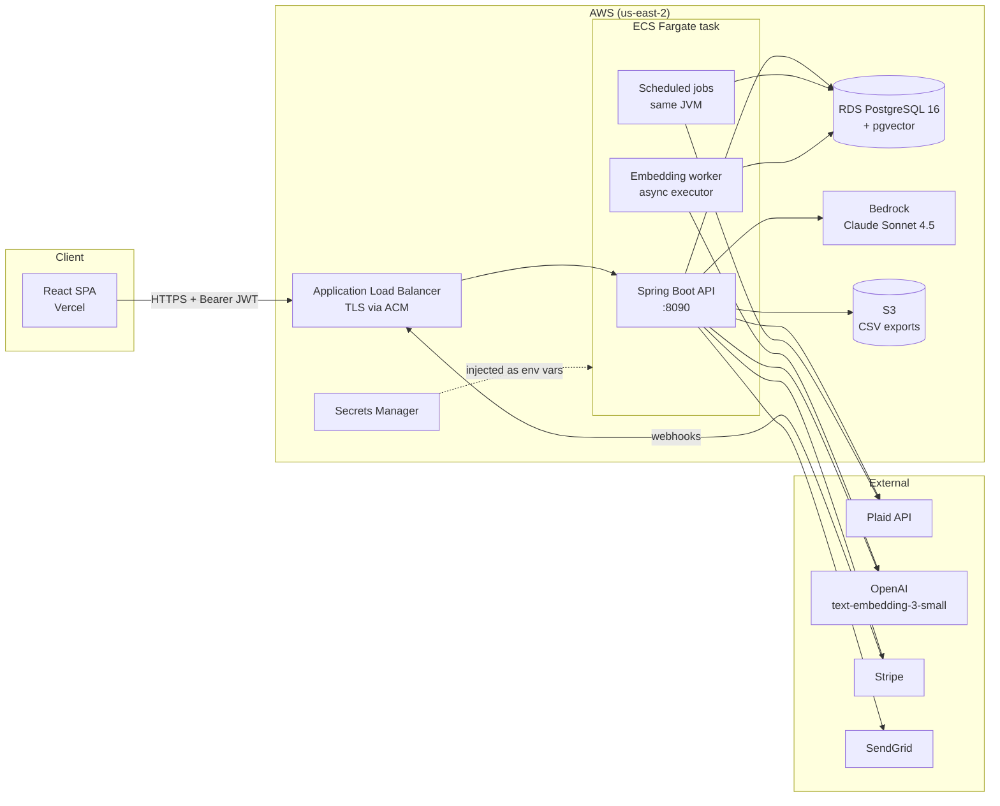
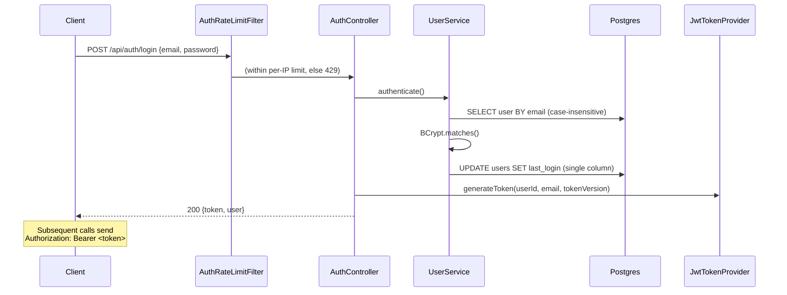
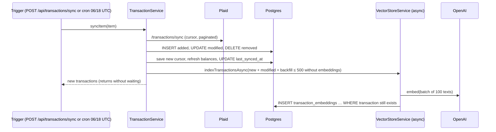
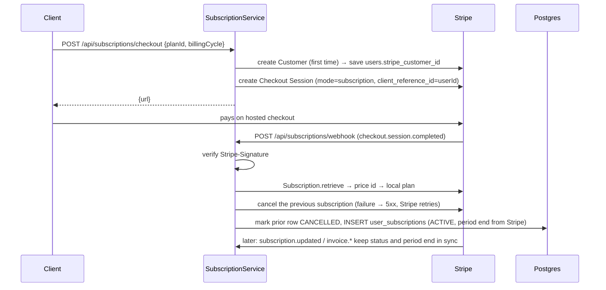
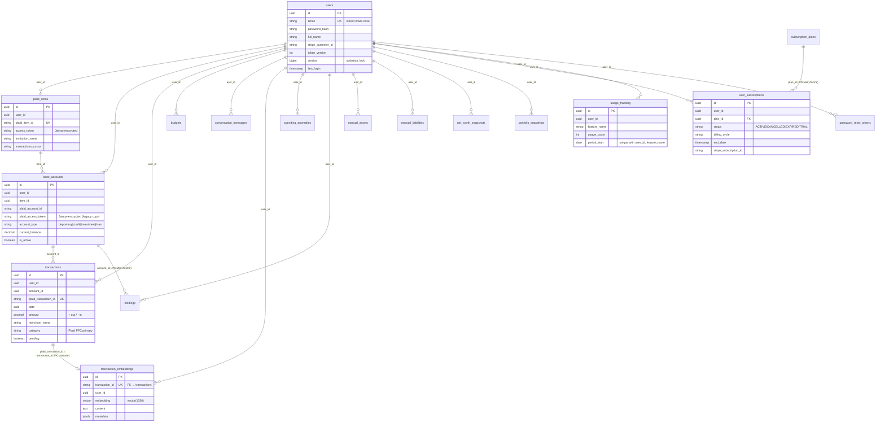
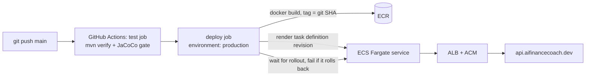

# Finance Coach Backend: System Design

> Last updated: 2026-10-20. Describes the code on `main` and the AWS deployment in `infra/terraform`.
> For known defects and open improvements, see [REVIEW.md](REVIEW.md).

---

## 1. What the system does

Finance Coach is a personal-finance API. A user signs up, links bank and brokerage accounts through **Plaid**, and the backend:

1. Pulls transactions and investment holdings into PostgreSQL.
2. Builds analytics (spending by category, trends, month-over-month comparisons), budgets, net worth and portfolio history.
3. Detects unusual spending with a per-category z-score.
4. Runs an **AI coach** (Claude on AWS Bedrock) grounded in the user's own data: exact monthly totals plus the most relevant transactions, retrieved through a RAG pipeline (OpenAI embeddings stored in pgvector).
5. Sells PREMIUM and PRO tiers through **Stripe Checkout**, and enforces FREE plan limits.

It is a single Spring Boot service (a modular monolith). Each business domain has its own controller and service, and all of them share one Postgres database.

---

## 2. High-level architecture



### Layering

```
HTTP ─► AuthRateLimitFilter ─► JwtAuthenticationFilter ─► Controller ─► FeatureAccessAspect ─► Service ─► Repository (JPA / JdbcTemplate) ─► Postgres
                                                                                                   └─► External client (Plaid / Bedrock / OpenAI / Stripe / SendGrid / S3)
```

| Package | Responsibility |
|---|---|
| `config` | Security filter chain, CORS, Plaid client, Jasypt encryptor, async executor, startup DB constraints and seed data, OpenAPI |
| `security` | JWT issue/validate, request filter, auth rate limiter, metrics access, JPA column encryption converter |
| `controller` | REST endpoints, one per domain. Extracts `userId` from the `SecurityContext` |
| `service` | Business logic, external integrations, scheduled jobs |
| `repository` | Spring Data JPA interfaces. Vector search and a few atomic upserts use `JdbcTemplate` / native SQL |
| `model` | JPA entities. Tables reference users by a raw `user_id UUID` (see §5 on foreign keys) |
| `dto` | Request/response objects with Bean Validation |
| `annotation` / `aspect` | Plan / feature-gating / usage-tracking AOP |
| `exception` | Domain exceptions + `GlobalExceptionHandler` mapping them to HTTP codes |

---

## 3. Domains and components

### 3.1 Identity & auth
- **`AuthController`** (`/api/auth/**`, public): register, login, forgot/reset password, validate reset token.
- **`UserService`**: BCrypt-hashed passwords, emails normalized to lower case (case-insensitive lookups), `lastLogin` written with a single-column update so a concurrent login can't overwrite other fields. `User` has a `@Version` column for optimistic locking.
- **`JwtTokenProvider`**: HS256 token, 24h TTL. `sub` is the user UUID, plus `email` and a `tokenVersion` claim. The filter rejects tokens whose version no longer matches `users.token_version`, which is bumped on password reset and account deletion, so those revoke every existing token.
- **`JwtAuthenticationFilter`**: reads `Authorization: Bearer …` and sets a principal that **is the `UUID`**. Unauthenticated requests get **401** (`HttpStatusEntryPoint`).
- **`AuthRateLimitFilter`**: per-IP limits on login (10 / 5 min), register (5 / h), forgot-password (5 / h) and reset-password (10 / h). It trusts `X-Forwarded-For` only from private (ALB) addresses and normalizes paths before matching.
- **`PasswordResetService`**: single-use token with a 1h TTL, 3 requests per 15 minutes per user, sent through SendGrid.
- **`AccountDeletionService`** (`DELETE /api/users/me`): cancels Stripe subscriptions and deletes the Stripe customer, revokes every Plaid item, then purges all of the user's rows in one database transaction. If Stripe or Plaid fails, nothing is deleted locally and the request can be retried (each step is idempotent).

### 3.2 Bank connectivity (Plaid)
- **`PlaidController`** (`/api/plaid/**`, JWT): create link token, exchange public token, list and disconnect accounts.
- **`PlaidService`**: wraps the Plaid Java SDK (retrofit). A **`PlaidItem`** (one bank login) owns the encrypted access token and the transactions sync cursor; each `BankAccount` points at its item through `item_id`. Tokens are encrypted at rest with Jasypt (`EncryptedStringConverter`, PBEWithHMACSHA512AndAES_256). Link tokens request transactions and investments with **730 days** of history.
- **Plan limits**: bank connections (items with an active account) are capped per plan. The check runs before Link opens and again just before saving, under a row lock on the user, so parallel connections can't exceed it; an item refused at that point is revoked at Plaid.
- **`TransactionService.syncItem`**: calls **`/transactions/sync`** from the item's cursor and applies added, modified and removed transactions, each attributed to the account Plaid reports. The cursor only advances once every change is saved. Balances are refreshed on each sync (only the values Plaid returns).
- **`TransactionSyncScheduler`**: runs at 06:00 and 18:00 UTC and syncs each item once.

### 3.3 Analytics, budgets, anomalies
- **`AnalyticsService`**: in-memory aggregation over `findByUserIdAndDateBetween`, using Plaid's sign convention (**positive = money out, negative = money in**). Transfers and credit-card / loan payments are excluded from spending and income totals.
- **`BudgetService`**: one budget per (user, category, month). It maps Plaid Personal Finance Categories to friendly budget categories (`FOOD_AND_DRINK` → `Food & Dining`, and so on) and recomputes `spent` when budgets are read. FREE users get 3 active budgets per month.
- **`AnomalyDetectionService`**: compares current-month spend per category against the mean and standard deviation of up to 6 prior months. It flags z ≥ 1.5 as LOW, ≥ 2 as MEDIUM and ≥ 3 as HIGH, one anomaly per category per month, on demand (`POST /api/anomalies/detect`).

### 3.4 Net worth & investments
- **`NetWorthService`**: net worth = cash (depository balances) + holdings value + manual assets − credit-card balances − manual liabilities. A daily 01:00 UTC snapshot is taken for every user.
- **`InvestmentService`**: calls Plaid `/investments/holdings/get` once per item and upserts on (account_id, security_id); positions no longer returned (sold) are deleted. A daily 02:00 UTC portfolio snapshot, plus an auto-sync every 30 minutes from 09:00 to 16:00 ET on weekdays.

### 3.5 AI coach (RAG)
- **`AICoachController`** (`/api/ai-coach/**`): chat, clear session, weekly summary, monthly report, category analysis, savings plan. All but clear-session count against the `ai_coach` limit (FREE: 5 per month).
- **`EmbeddingService`**: turns a transaction into one sentence and embeds it with OpenAI `text-embedding-3-small` (1536-dim) through Spring AI, in batches of 100.
- **`VectorStoreService`**: indexing runs **asynchronously** on the `embeddingExecutor` (1–2 threads, queue of 200). The insert only lands while the transaction still exists. Retrieval returns the top-K rows by cosine distance (`<=>`), scoped to `user_id`.
- **`AICoachService`**: the system prompt combines an exact financial summary (spending, income, spending by category and top merchants, for this month to date and last month), so "how much" questions get real numbers, with the top 10 retrieved transactions for specific lookups.
- **`ConversationService`**: stores each turn (user message + assistant reply) keyed by `(user_id, session_id)` and replays the last 10 turns.
- **`ClaudeService`**: Bedrock `InvokeModel` with the Anthropic Messages body, using the ECS task role. Bedrock failures throw `AiServiceUnavailableException` (→ 503); failed turns aren't saved and don't use up the allowance.

### 3.6 Billing
- **`SubscriptionController`** (`/api/subscriptions/**`): list plans (public), current subscription, feature-access check, checkout, cancel, Stripe webhook (public, signature-verified).
- **Stripe is the source of truth.** Checkout sessions carry `client_reference_id = userId`. The webhook handles `checkout.session.completed`, `customer.subscription.created/updated/deleted` and `invoice.payment_succeeded/failed`, copying status and period end into `user_subscriptions`. Handler errors propagate (5xx) so Stripe retries; already-recorded subscriptions are skipped.
- **Upgrades** cancel the previous Stripe subscription; if that fails, the event fails and Stripe retries rather than leaving two subscriptions billing. **Cancel** uses `cancel_at_period_end`, so access lasts until the period ends.
- **Usage limits**: `@TrackUsage` reserves a use atomically before the call (`INSERT … ON CONFLICT DO UPDATE … WHERE usage_count < limit` on `usage_tracking`) and releases it if the call fails. `@RequiresFeature` checks plan access. Limits live in `SubscriptionService#getFeatureLimit`:

| Feature | FREE | PREMIUM | PRO |
|---|---|---|---|
| `ai_coach` (per month) | 5 | unlimited | unlimited |
| `budget_create` (active per month) | 3 | unlimited | unlimited |
| `bank_account` (connections) | 1 | 5 | unlimited |
| `export_reports` | — | unlimited | unlimited |

### 3.7 Export
- **`ExportService`** + **`S3Service`**: builds a CSV of the user's transactions, uploads it to the bucket in `S3_EXPORT_BUCKET` under `exports/{userId}/…`, and returns a 15-minute presigned URL. Paid plans only.

### 3.8 Observability
- Actuator: `health` and `info` are public (the ALB health check uses `/actuator/health`). `metrics` and `prometheus` require `Authorization: Bearer $METRICS_TOKEN` and are unreachable when no token is set.
- **`MetricsService`**: Micrometer counters and timers (registrations, logins, password resets, bank connections, transactions synced, Plaid latency, AI requests, budgets created/exceeded).
- Logs go to CloudWatch (`/ecs/finance-coach-backend`, 7-day retention) in prod, and to console plus a rolling file in dev.

---

## 4. Key request flows

### 4.1 Register / login



### 4.2 Linking a bank (Plaid Link)

```mermaid
sequenceDiagram
    participant C as Client (Plaid Link UI)
    participant P as PlaidController/Service
    participant PL as Plaid
    participant DB as Postgres
    C->>P: POST /api/plaid/create-link-token
    P->>DB: check bank connection limit
    P->>PL: /link/token/create (transactions + investments, 730 days)
    P-->>C: link_token
    C->>PL: User authenticates with bank in Plaid Link
    PL-->>C: public_token
    C->>P: POST /api/plaid/exchange-token {publicToken}
    P->>PL: /item/public_token/exchange → access_token, item_id
    P->>PL: /accounts/get, /institutions/get_by_id
    P->>DB: BEGIN; lock user row; re-check limit
    P->>DB: UPSERT plaid_items (token encrypted); INSERT bank_accounts; COMMIT
    P-->>C: [accounts]
```

### 4.3 Transaction sync + indexing



### 4.4 AI coach chat (RAG)

```mermaid
sequenceDiagram
    participant C as Client
    participant FA as FeatureAccessAspect
    participant AC as AICoachService
    participant VS as VectorStoreService
    participant DB as Postgres
    participant CV as ConversationService
    participant BR as Bedrock (Claude)
    C->>FA: POST /api/ai-coach/chat {message, sessionId}
    FA->>DB: reserve 1 ai_coach use (atomic; 429 at limit)
    FA->>AC: chat()
    AC->>DB: exact summary (this and last month: totals, categories, top merchants)
    AC->>VS: retrieveRelevantContext(userId, message) → top 10
    AC->>CV: getHistory(userId, sessionId) (last 10 turns)
    AC->>BR: InvokeModel(system, history + message)
    BR-->>AC: assistant text
    AC->>CV: saveMessage(turn)
    AC-->>C: {response}
    Note over FA: On failure the use is released<br/>and Bedrock errors return 503
```

The report endpoints (weekly summary, monthly report, category analysis, savings plan) skip retrieval. They compute aggregates with `AnalyticsService` and send them to Claude in a single-shot prompt.

### 4.5 Upgrading (Stripe)



---

## 5. Data model

Tables are created by Hibernate (`ddl-auto: update`). Things Hibernate can't express are added at startup:
- `schema.sql` enables the `vector` extension.
- **`DatabaseConstraints`** adds the `transaction_embeddings → transactions` foreign key (`ON DELETE CASCADE`) and the unique index on `usage_tracking (user_id, feature_name, period_start)`, cleaning up orphans and duplicates first.
- **`SubscriptionPlanSeeder`** seeds the FREE / PREMIUM / PRO plans and feature flags.



Most relationships above are **logical**: apart from the embeddings foreign key and the two JPA associations, links are bare UUID columns. Account deletion removes everything explicitly in `AccountDeletionService`. Adding the remaining parent foreign keys is open (REVIEW.md, follow-up #1).

### Indexes
| Table | Index |
|---|---|
| transactions | `(user_id, date)`, `plaid_transaction_id` (unique) |
| conversation_messages | `(user_id, session_id)`, `created_at` |
| spending_anomalies | `user_id`, `detected_at` |
| holdings | `user_id`, `account_id`, `symbol`, unique `(account_id, security_id)` |
| password_reset_tokens | `token`, `(user_id, expiry_date)` |
| usage_tracking | unique `(user_id, feature_name, period_start)` |
| transaction_embeddings | unique `transaction_id`. **No ANN index** yet, so similarity search scans the user's rows |

---

## 6. Background jobs

All jobs run inside the API process on Spring's default **single-threaded** scheduler, with no distributed lock. Embedding runs separately on the `embeddingExecutor`.

| Job | Schedule | What it does |
|---|---|---|
| `NetWorthService.takeNetWorthSnapshots` | 01:00 daily (UTC) | Net-worth snapshot for every user |
| `InvestmentService.takePortfolioSnapshots` | 02:00 daily (UTC) | Portfolio snapshot for users with investment accounts |
| `TransactionSyncScheduler.syncAllAccounts` | 06:00 and 18:00 (UTC) | `/transactions/sync` for every item with an active account |
| `InvestmentService.autoSyncHoldings` | Every 30 min, 09:00–16:00 ET, Mon–Fri | Holdings pull for every investing user |

Implications: ECS runs one task (`desired_count = 1`). Running more would run every job once per task until ShedLock is added. A long job delays the others because the scheduler has one thread.

---

## 7. Security model

| Concern | Current approach |
|---|---|
| Authentication | Stateless HS256 JWT, 24h, bearer header, revocable through `token_version` |
| Authorization | Ownership checks inside services (`entity.userId == currentUserId`). There are no roles |
| Public routes | `/api/auth/**`, `/api/users/health`, `/actuator/health/**`, `/actuator/info`, Swagger, `/api/subscriptions/plans`, `/api/subscriptions/webhook` |
| Brute force | Per-IP rate limits on the auth endpoints (§3.1) |
| Passwords | BCrypt (strength 10) |
| Secrets | AWS Secrets Manager (`finance-coach/prod`) → ECS env vars. Local: gitignored `application-dev.yml` |
| Data at rest | Plaid access tokens encrypted with Jasypt AES-256. RDS storage encryption for the rest |
| CORS | `http://localhost:*`, `https://*.vercel.app`, with credentials allowed (pinning is open in REVIEW.md) |
| Webhooks | Stripe signature verification (`Webhook.constructEvent`) |
| CSRF | Disabled (fine for a bearer-token API) |

---

## 8. Deployment

Infrastructure is defined in **Terraform** (`infra/terraform`) on an AWS account limited to **us-east-2**.



| Resource | Setup |
|---|---|
| Network | VPC with public subnets for the ALB and tasks (no NAT gateway); RDS in private subnets |
| Compute | ECS Fargate, 0.5 vCPU / 1 GB, one task, `awsvpc` |
| Database | RDS PostgreSQL 16, `db.t4g.micro`, 20 GB, single-AZ, master password managed by RDS |
| Load balancer | ALB with an ACM certificate for `api.aifinancecoach.dev` (DNS at Namecheap) |
| Secrets | Secrets Manager `finance-coach/prod`, injected as env vars |
| IAM | Task role for Bedrock (inference profiles) and the S3 exports bucket; a deploy identity for GitHub Actions |
| Registry / logs | ECR with a lifecycle policy; CloudWatch logs, 7-day retention |

- **CI**: the test job runs `./mvnw verify` (service-layer coverage gate: ≥ 90% lines, ≥ 80% branches) and uploads the coverage report. The deploy job runs only on `main` in the `production` environment. It uses an OIDC role when `AWS_DEPLOY_ROLE_ARN` is set, otherwise an IAM user's access keys (the account blocks creating OIDC providers). Actions are pinned to commit SHAs, and Dependabot keeps them updated.
- **Image**: multi-stage Dockerfile (Maven build → `eclipse-temurin:21-jre`), heap 256–512 MB, port 8090, `prod` profile by default.
- **Profiles**: `prod` in ECS, `dev` locally with the gitignored `application-dev.yml`.
- `render.yaml` is a leftover from an earlier Render deployment and is unused.

### Configuration reference
| Env var | Used for |
|---|---|
| `DB_URL`, `DB_USERNAME`, `DB_PASSWORD` | Postgres |
| `JWT_SECRET` | HS256 signing key (≥ 32 bytes) |
| `JASYPT_ENCRYPTOR_PASSWORD` | Plaid token encryption key. **Rotating it makes existing tokens unreadable** |
| `PLAID_CLIENT_ID`, `PLAID_SECRET`, `PLAID_ENVIRONMENT` | Plaid (`sandbox` by default) |
| `OPENAI_API_KEY` | Embeddings |
| `CLAUDE_MODEL`, `CLAUDE_MAX_TOKENS` | Bedrock model or inference-profile ID (default `us.anthropic.claude-sonnet-4-5-20250929-v1:0`) |
| `AWS_REGION` | Bedrock and S3 region (default `us-east-2`) |
| `S3_EXPORT_BUCKET` | Bucket for CSV exports |
| `STRIPE_API_KEY`, `STRIPE_WEBHOOK_SECRET` | Billing |
| `SENDGRID_API_KEY`, `SENDGRID_FROM_EMAIL`, `SENDGRID_FROM_NAME` | Email |
| `APP_FRONTEND_URL`, `APP_API_URL` | Links in emails, Stripe redirect URLs, OpenAPI server |
| `METRICS_TOKEN` | Bearer token for `/actuator/metrics` and `/actuator/prometheus` |
| AWS credentials | Default provider chain (task role in ECS, profile locally) for Bedrock and S3 |

---

## 9. API surface (summary)

| Base path | Auth | Endpoints |
|---|---|---|
| `/api/auth` | public | `POST register`, `POST login`, `POST forgot-password`, `POST reset-password`, `GET validate-reset-token/{token}` |
| `/api/users` | JWT | `GET health` (public), `GET me`, `DELETE me` |
| `/api/plaid` | JWT | `POST create-link-token`, `POST exchange-token`, `GET accounts`, `DELETE accounts/{id}` |
| `/api/transactions` | JWT | `POST sync`, `POST sync/{accountId}`, `GET ?startDate&endDate`, `GET category/{category}` |
| `/api/analytics` | JWT | `spending-by-category`, `total-spending`, `total-income`, `top-merchants`, `spending-trend`, `monthly-summary`, `compare-months` |
| `/api/budgets` | JWT | `POST /`, `GET current`, `GET ?month`, `GET progress`, `DELETE {id}`, `GET recommendations`, `GET exceeded`, `GET alerts`, `POST refresh`, `POST copy-previous` |
| `/api/anomalies` | JWT | `POST detect`, `GET /`, `GET unreviewed`, `GET count`, `PUT {id}/review` |
| `/api/ai-coach` | JWT | `POST chat`, `DELETE chat/{sessionId}`, `GET weekly-summary`, `GET monthly-report`, `GET analyze-category/{c}`, `POST savings-recommendations` |
| `/api/net-worth` | JWT | `GET current`, `GET history`, CRUD `assets`, CRUD `liabilities` |
| `/api/investments` | JWT | `POST sync`, `POST sync/{accountId}`, `GET portfolio`, `GET holdings/{accountId}`, `GET allocation`, `GET history` |
| `/api/subscriptions` | mixed | `GET plans` (public), `GET current`, `GET features/{f}/access`, `POST checkout`, `POST cancel`, `POST webhook` (public, Stripe-signed) |
| `/api/export` | JWT, paid plans | `GET transactions` → presigned S3 URL |

Full interactive docs are at `/swagger-ui.html`.

---

## 10. Where to go next

Open structural changes from [REVIEW.md](REVIEW.md):
- Parent foreign keys with `ON DELETE CASCADE`, then **Flyway** migrations with `ddl-auto: validate`.
- **Plaid webhooks** (`SYNC_UPDATES_AVAILABLE`, `ITEM_LOGIN_REQUIRED`) instead of twice-daily polling, plus a reconnect flow.
- **Tool use** for the AI coach (`get_spending_by_category`, `get_transactions`, …) on top of the summary and RAG.
- An HNSW index on `transaction_embeddings`.
- **ShedLock** before running more than one ECS task.
- Repository tests on Testcontainers Postgres + pgvector.
