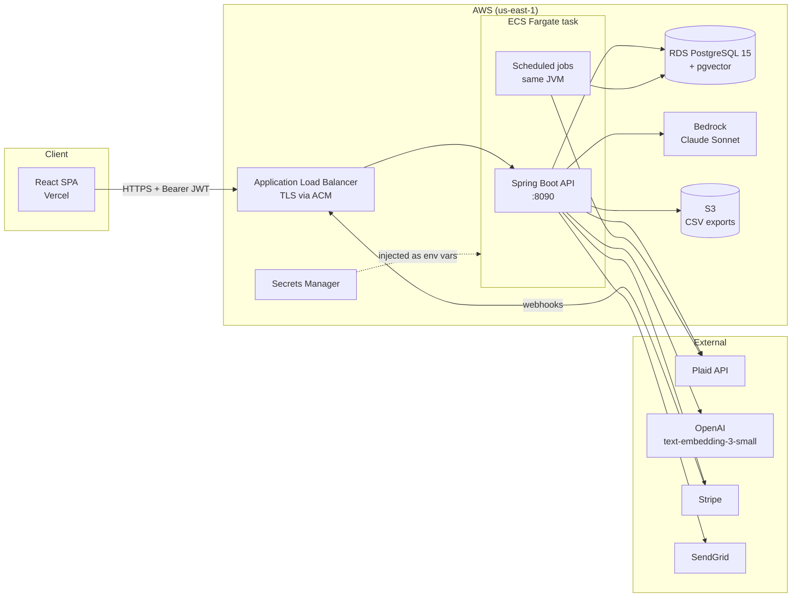
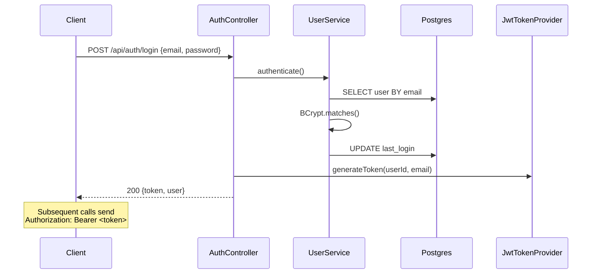
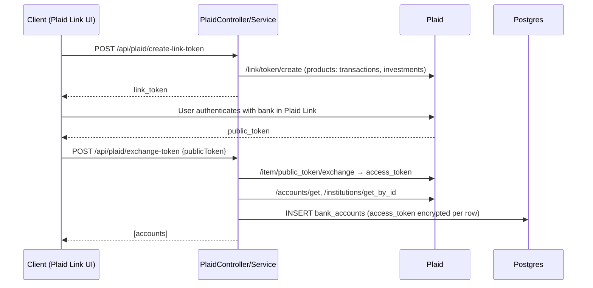
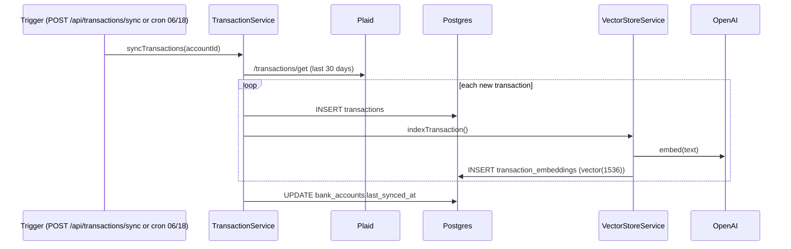
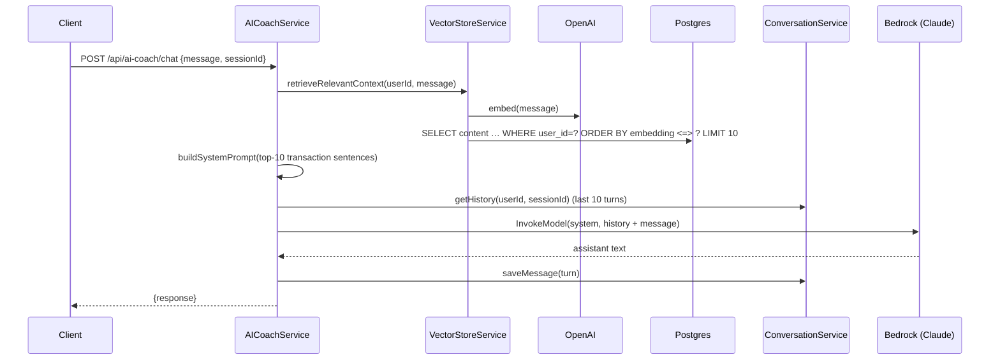
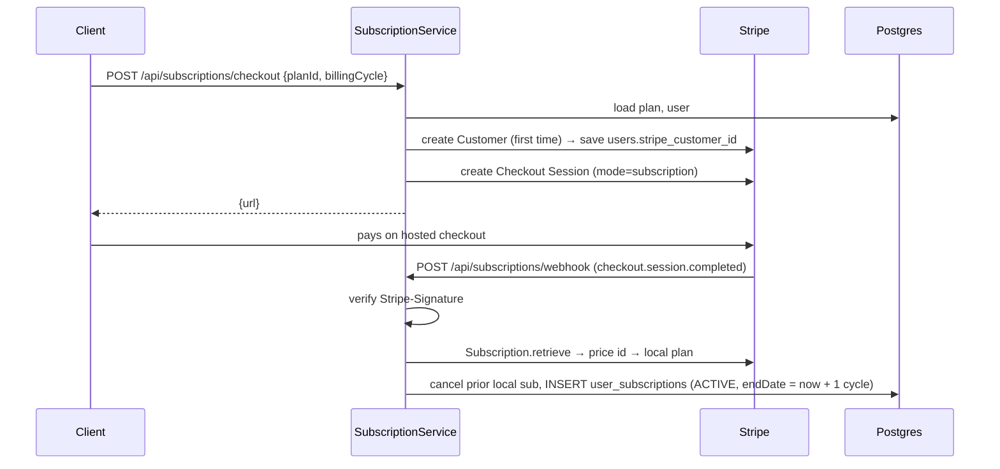
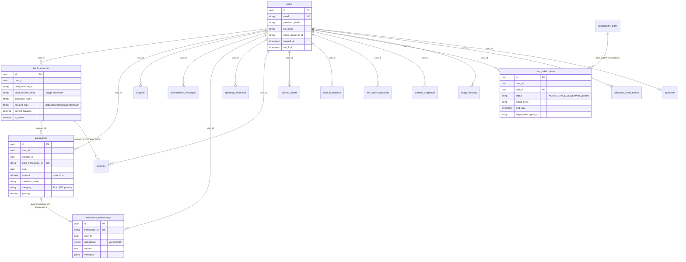
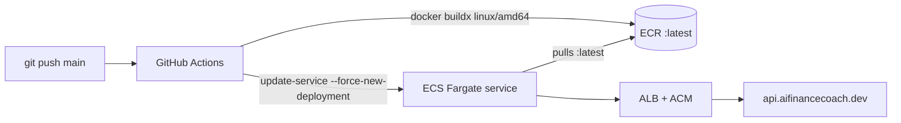
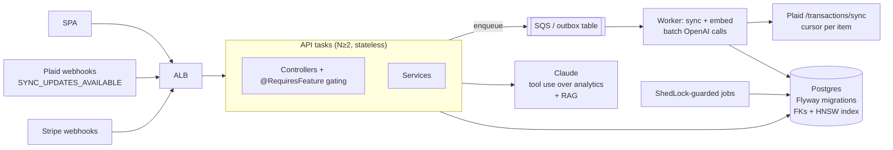

# Finance Coach Backend: System Design

> Last updated: 2026-10-13. Describes the code on `main` as of commit `8dbebbc`.
> For known defects and the improvement roadmap, see [REVIEW.md](REVIEW.md).

---

## 1. What the system does

Finance Coach is a personal-finance API. A user signs up, links bank and brokerage accounts through **Plaid**, and the backend:

1. Pulls transactions and investment holdings into PostgreSQL.
2. Builds analytics (spending by category, trends, month-over-month comparisons), budgets, net worth and portfolio history.
3. Detects unusual spending with a per-category z-score.
4. Runs an **AI coach** (Claude on AWS Bedrock) grounded in the user's own transactions through a RAG pipeline (OpenAI embeddings stored in pgvector).
5. Sells PREMIUM and PRO tiers through **Stripe Checkout**.

It is a single Spring Boot service (a modular monolith). Each business domain has its own controller and service, and all of them share one Postgres database.

---

## 2. High-level architecture



### Layering

```
HTTP ─► JwtAuthenticationFilter ─► Controller ─► [FeatureAccessAspect*] ─► Service ─► Repository (JPA / JdbcTemplate) ─► Postgres
                                                                              └─► External client (Plaid / Bedrock / OpenAI / Stripe / SendGrid / S3)
```
\* The aspect exists but no endpoint uses its annotations yet. See REVIEW.md §1.

| Package | Responsibility |
|---|---|
| `config` | Security filter chain, CORS, Plaid client, Jasypt encryptor, OpenAPI, BCrypt |
| `security` | JWT issue/validate, request filter, JPA column encryption converter |
| `controller` | REST endpoints, one per domain. Extracts `userId` from the `SecurityContext` |
| `service` | Business logic, external integrations, scheduled jobs |
| `repository` | Spring Data JPA interfaces. Vector search uses `JdbcTemplate` |
| `model` | JPA entities. Tables reference users by a raw `user_id UUID` (no FK relations) |
| `dto` | Request/response objects with Bean Validation |
| `annotation` / `aspect` | Plan / feature-gating / usage-tracking AOP |
| `exception` | Domain exceptions + `GlobalExceptionHandler` mapping them to HTTP codes |

---

## 3. Domains and components

### 3.1 Identity & auth
- **`AuthController`** (`/api/auth/**`, public): register, login, forgot/reset password, validate reset token.
- **`UserService`**: BCrypt-hashed passwords and `lastLogin` tracking.
- **`JwtTokenProvider`**: HS256 token. `sub` is the user UUID and the `email` claim holds the email. The TTL is `jwt.expiration` (24h). There are no refresh tokens and no revocation.
- **`JwtAuthenticationFilter`**: reads `Authorization: Bearer …`. On a valid token it sets a `UsernamePasswordAuthenticationToken` whose **principal is the `UUID`** and which has no authorities. Controllers cast `getPrincipal()` to `UUID`.
- **`PasswordResetService`**: random UUID token with a 1h TTL and single use. It allows 3 requests per 15 minutes per user and sends the email through SendGrid.

### 3.2 Bank connectivity (Plaid)
- **`PlaidController`** (`/api/plaid/**`): create link token, exchange public token, list and disconnect accounts.
- **`PlaidService`**: wraps the Plaid Java SDK (retrofit). On exchange it fetches accounts and the institution name, then saves **one `BankAccount` row per Plaid account**. Each row stores a copy of the item's access token, encrypted at rest with Jasypt (`EncryptedStringConverter`, PBEWithHMACSHA512AndAES_256).
- **`TransactionService`**: calls `/transactions/get` for the last 30 days per account, skips IDs it has already seen, saves `Transaction`s and indexes each one into the vector store.
- **`TransactionSyncScheduler`**: runs at 06:00 and 18:00 (server time, UTC on Fargate) and syncs every active account.

### 3.3 Analytics, budgets, anomalies
- **`AnalyticsService`**: in-memory aggregation over `findByUserIdAndDateBetween`. It follows Plaid's sign convention: **positive = money out, negative = money in**.
- **`BudgetService`**: one budget per (user, category, month). It maps Plaid Personal Finance Categories to friendly budget categories (`FOOD_AND_DRINK` → `Food & Dining`, and so on; transfers and income are excluded) and recomputes `spent` whenever budgets are read.
- **`AnomalyDetectionService`**: compares current-month spend per category against the mean and standard deviation of up to 6 prior months. It flags z ≥ 1.5 as LOW, ≥ 2 as MEDIUM and ≥ 3 as HIGH, and only runs on demand (`POST /api/anomalies/detect`).

### 3.4 Net worth & investments
- **`NetWorthService`**: net worth = cash (depository balances) + holdings value + manual assets − credit-card balances − manual liabilities. A daily 01:00 snapshot is taken for every user.
- **`InvestmentService`**: calls Plaid `/investments/holdings/get` and upserts on (account_id, security_id). It takes a daily 02:00 portfolio snapshot and auto-syncs every 30 minutes from 09:00 to 16:00 ET on weekdays.

### 3.5 AI coach (RAG)
- **`AICoachController`** (`/api/ai-coach/**`): chat, clear session, weekly summary, monthly report, category analysis, savings plan.
- **`EmbeddingService`**: turns a transaction into one sentence and embeds it with OpenAI `text-embedding-3-small` (1536-dim) through Spring AI.
- **`VectorStoreService`**: writes to `transaction_embeddings` (pgvector) and retrieves the top-K rows by cosine distance (`<=>`), scoped to `user_id`.
- **`ConversationService`**: stores each turn as one row (user message + assistant reply) keyed by `(user_id, session_id)` and replays the last 10 turns.
- **`ClaudeService`**: Bedrock `InvokeModel` using the Anthropic Messages body (`anthropic_version: bedrock-2023-05-31`). It uses the AWS default credential chain (the ECS task role).

### 3.6 Billing
- **`SubscriptionController`** (`/api/subscriptions/**`): list plans (public), current subscription, feature-access check, checkout, cancel, Stripe webhook (public, signature-verified).
- **`SubscriptionService`**: plan lookups, usage counters (`usage_tracking`, one row per user/feature/month), and Stripe Checkout session creation. `checkout.session.completed` creates the local `UserSubscription`. The other webhook types are logged but not handled yet.
- **`FeatureAccessAspect`**: `@RequiresPlan`, `@RequiresFeature` and `@TrackUsage` advice, backed by the `feature_flags` table and hard-coded limits in `SubscriptionService#getFeatureLimit`.

### 3.7 Export
- **`ExportService`** + **`S3Service`**: builds a CSV of all of the user's transactions, uploads it to `s3://finance-coach-exports-516737672838/exports/{userId}/…`, and returns a 15-minute presigned GET URL.

### 3.8 Observability
- Actuator: `health`, `info`, `metrics`, `prometheus`.
- **`MetricsService`**: custom Micrometer counters and timers (registrations, logins, Plaid latency, sync counts, AI request latency, budgets created).
- Logging goes to the console in prod and to console plus a rolling file (`logs/`) in dev.

---

## 4. Key request flows

### 4.1 Register / login



### 4.2 Linking a bank (Plaid Link)



### 4.3 Transaction sync + indexing



Everything in this flow runs synchronously on the request thread, including one OpenAI call per new transaction.

### 4.4 AI coach chat (RAG)



The report endpoints (weekly summary, monthly report, category analysis, savings plan) skip retrieval. They compute aggregates with `AnalyticsService` and send them to Claude in a single-shot prompt.

### 4.5 Upgrading (Stripe)



---

## 5. Data model

All tables are created by Hibernate (`ddl-auto: update`). There are no migration scripts. Plans and feature flags must be seeded by hand: the code expects a `FREE` row in `subscription_plans`.



Relationships drawn above are **logical**. Only `holdings → bank_accounts` and `user_subscriptions → subscription_plans` are JPA associations. Every other link is a bare UUID column with no database foreign key, so deletes do not cascade.

### Indexes
| Table | Index |
|---|---|
| transactions | `(user_id, date)`, `plaid_transaction_id` (unique) |
| conversation_messages | `(user_id, session_id)`, `created_at` |
| spending_anomalies | `user_id`, `detected_at` |
| holdings | `user_id`, `account_id`, `symbol`, unique `(account_id, security_id)` |
| password_reset_tokens | `token`, `(user_id, expiry_date)` |
| transaction_embeddings | unique `transaction_id` only. **No ANN index** (no HNSW/IVFFlat), so similarity search is a sequential scan per user |

---

## 6. Background jobs

All jobs run inside the API process on Spring's default **single-threaded** scheduler, with no distributed lock.

| Job | Schedule | What it does |
|---|---|---|
| `NetWorthService.takeNetWorthSnapshots` | 01:00 daily (server TZ) | Computes and inserts a net-worth snapshot for **every** user |
| `InvestmentService.takePortfolioSnapshots` | 02:00 daily (server TZ) | Inserts a portfolio snapshot for users with investment accounts |
| `TransactionSyncScheduler.syncAllAccounts` | 06:00 and 18:00 (server TZ) | Plaid transaction pull for every active account |
| `InvestmentService.autoSyncHoldings` | Every 30 min, 09:00–16:00 ET, Mon–Fri | Plaid holdings pull for every investing user, sleeping 2s between users |

Implications: if ECS runs more than one task, every job runs once per task. A long job delays the others because the scheduler has one thread.

---

## 7. Security model

| Concern | Current approach |
|---|---|
| Authentication | Stateless HS256 JWT, 24h, bearer header |
| Authorization | Ownership checks inside services (`entity.userId == currentUserId`). There are no roles. |
| Public routes | `/api/auth/**`, `/api/users/health`, `/api/plaid/**` (⚠), `/actuator/**`, Swagger, `/api/subscriptions/plans`, `/api/subscriptions/webhook` |
| Passwords | BCrypt (strength 10) |
| Secrets | AWS Secrets Manager → ECS env vars. Local: gitignored `application-dev.yml` / `.env` |
| Data at rest | Plaid access tokens encrypted with Jasypt AES-256. Everything else is plaintext, relying on RDS storage encryption |
| CORS | `http://localhost:*`, `https://*.vercel.app`, with credentials allowed |
| Webhooks | Stripe signature verification (`Webhook.constructEvent`) |
| CSRF | Disabled (fine for a bearer-token API) |

---

## 8. Deployment



- **Image**: multi-stage Dockerfile (Maven build with `-DskipTests` → `eclipse-temurin:21-jre`), heap 256–512MB, port 8090.
- **Task**: 0.5 vCPU / 2GB, `awsvpc` networking, secrets from `finance-coach/prod`, and a task role for Bedrock and S3.
- **Profiles**: `prod` (`application-prod.yml`) in ECS. `dev` locally, using the gitignored `application-dev.yml`.
- `render.yaml` is a leftover from an earlier Render deployment and is no longer the live path.

### Configuration reference
| Env var | Used for |
|---|---|
| `DB_URL`, `DB_USERNAME`, `DB_PASSWORD` | Postgres |
| `JWT_SECRET` | HS256 signing key (≥ 32 bytes) |
| `JASYPT_ENCRYPTOR_PASSWORD` | Plaid token encryption key. **Rotating it makes existing tokens unreadable** |
| `PLAID_CLIENT_ID`, `PLAID_SECRET`, `PLAID_ENVIRONMENT` | Plaid |
| `OPENAI_API_KEY` | Embeddings |
| `CLAUDE_MODEL`, `CLAUDE_MAX_TOKENS` | Bedrock model ID (must be a Bedrock ID such as `anthropic.claude-…` or an inference profile) |
| `STRIPE_API_KEY`, `STRIPE_WEBHOOK_SECRET` | Billing |
| `SENDGRID_API_KEY`, `SENDGRID_FROM_EMAIL`, `SENDGRID_FROM_NAME` | Email |
| `APP_FRONTEND_URL` | Links in emails, Stripe redirect URLs |
| AWS credentials | Default provider chain (task role in ECS, profile locally) for Bedrock and S3 |

---

## 9. API surface (summary)

| Base path | Auth | Endpoints |
|---|---|---|
| `/api/auth` | public | `POST register`, `POST login`, `POST forgot-password`, `POST reset-password`, `GET validate-reset-token/{token}` |
| `/api/users` | JWT | `GET health` (public), `GET me`, `DELETE me`, `GET /` ⚠, `GET /{id}` ⚠ |
| `/api/plaid` | ⚠ public in config | `POST create-link-token`, `POST exchange-token`, `GET accounts`, `DELETE accounts/{id}` |
| `/api/transactions` | JWT | `POST sync`, `POST sync/{accountId}`, `GET ?startDate&endDate`, `GET category/{category}` |
| `/api/analytics` | JWT | `spending-by-category`, `total-spending`, `total-income`, `top-merchants`, `spending-trend`, `monthly-summary`, `compare-months` |
| `/api/budgets` | JWT | `POST /`, `GET current`, `GET ?month`, `GET progress`, `DELETE {id}`, `GET recommendations`, `GET exceeded`, `GET alerts`, `POST refresh`, `POST copy-previous` |
| `/api/anomalies` | JWT | `POST detect`, `GET /`, `GET unreviewed`, `GET count`, `PUT {id}/review` |
| `/api/ai-coach` | JWT | `POST chat`, `DELETE chat/{sessionId}`, `GET weekly-summary`, `GET monthly-report`, `GET analyze-category/{c}`, `POST savings-recommendations` |
| `/api/net-worth` | JWT | `GET current`, `GET history`, CRUD `assets`, CRUD `liabilities` |
| `/api/investments` | JWT | `POST sync`, `POST sync/{accountId}`, `GET portfolio`, `GET holdings/{accountId}`, `GET allocation`, `GET history` |
| `/api/subscriptions` | mixed | `GET plans` (public), `GET current`, `GET features/{f}/access`, `POST checkout`, `POST cancel`, `POST webhook` (public, Stripe-signed) |
| `/api/export` | JWT | `GET transactions` → presigned S3 URL |

Full interactive docs are at `/swagger-ui.html`.

---

## 10. Target architecture (where to go next)

These are the structural changes recommended in [REVIEW.md](REVIEW.md), shown together:



The main changes:
- A `plaid_items` table owns the access token and sync cursor. `bank_accounts` hang off it.
- Plaid `/transactions/sync`, driven by webhooks, replaces the 30-day poll.
- Embedding moves off the request path into a worker.
- The AI coach answers aggregate questions through **tool calls** into `AnalyticsService` instead of nearest-neighbour retrieval alone.
- Stripe webhooks become the source of truth for subscription state.
- Flyway migrations, FKs with `ON DELETE CASCADE`, and ShedLock for jobs.
